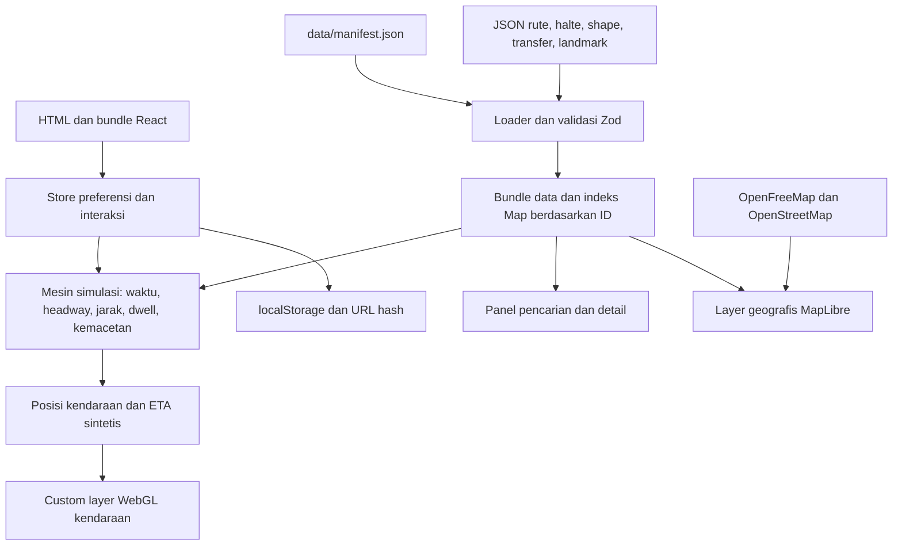

# Reverse engineering Simpul

Target: https://simpul.adenaufal.com/  
Tanggal pemeriksaan: 16 Oktober 2026, Asia/Jakarta.

## Kesimpulan

Simpul adalah aplikasi React untuk menjelajahi jaringan transportasi Jabodetabek. Data rute dan halte diambil dari JSON statis. Posisi kendaraan, ETA, dan okupansi dihitung di frontend menggunakan waktu simulasi. MapLibre menggambar peta dan layer geografis; kendaraan memakai custom layer WebGL dengan instanced rendering.

Analisis ini berasal dari HTML, header HTTP, bundle JavaScript/CSS publik, dataset yang dirujuk aplikasi, dan percobaan render browser. Ini bukan pemulihan repository atau kode server asli. Tidak ada perubahan pada situs target.

## Teknologi dan tingkat kepastian

| Bagian | Temuan | Bukti / batas kepastian |
| --- | --- | --- |
| UI | React 18.3.1 dan React DOM | String versi di `evidence/vendor-react.js`, entry `createRoot` di bundle utama |
| Peta | MapLibre GL | Import bundle terpisah dari HTML dan API MapLibre di bundle utama |
| State | Zustand dengan persist dan subscription | Implementasi store serta middleware Zustand di bundle |
| Validasi | Zod | Schema object, refinement, dan error Zod di bundle |
| CSS | Utility CSS bergaya Tailwind, sangat mungkin Tailwind | Utility dan variabel `--tw-*`; konfigurasi/build source tidak tersedia |
| Build | Sangat mungkin Vite | Module preload polyfill dan aset berhash; package/build config belum diketahui |
| Font | IBM Plex Sans, Sans Condensed, Mono | CSS font lokal; HTML memuat awal Sans 400/600 |
| Infrastruktur | Cloudflare di depan situs; indikasi Pages | Header server dan komentar Pages Analytics di HTML; origin tidak teridentifikasi |
| Audio | Web Audio API dan pengumuman halte | Oscillator, noise buffer, AudioContext, serta pemanggilan pengumuman dalam bundle |

UI mencantumkan versi aplikasi `v2.5.0`. Manifest mencantumkan versi dataset `2.1.0`; kedua angka tersebut merujuk komponen berbeda.

## Arsitektur yang dapat diturunkan



Halaman awal menjalankan loader data dan membuat peta. Loader mengambil manifest, kemudian memuat operator, file rute pertama (rel), halte rel, shape rel, dan landmark secara paralel. Transfer dimuat setelah kelompok tersebut dan boleh gagal tanpa menggagalkan keseluruhan loader.

Fungsi loader lanjutan mengambil sisa file rute, halte, dan shape, kemudian menggabungkannya. Pada snapshot ini artinya BRT dan bus. Ada state loading/failed/retrying dan kontrol retry untuk kelompok data ini.

Indeks `routesById`, `stopsById`, dan `agenciesById` berupa JavaScript `Map`. Jalur data utama yang ditemukan menggunakan `fetch` JSON dan style peta. Tidak terlihat kebutuhan API posisi kendaraan atau WebSocket untuk menjalankan simulasi ini. Temuan tersebut tidak membuktikan bahwa seluruh infrastruktur situs bebas backend.

## Dataset yang diverifikasi

Sumber: [manifest publik](https://simpul.adenaufal.com/data/manifest.json), salinan lokal `evidence/manifest.json`.

Manifest dibuat `2026-10-03T14:50:07.204Z`, dengan revision `7c6aa145be5f27b896823346338cbb3358e768452d6bcd341a34b0a5c43c4f42`.

| Entitas | Jumlah dari file yang diunduh |
| --- | ---: |
| Operator | 8 |
| Rute | 31 |
| Halte/stasiun unik | 988 |
| Pola perjalanan | 66 |
| Geometri jalur | 66 |
| Koneksi perpindahan | 111 |
| Landmark | 5 |

Rute terdiri dari 1 MRT, 3 LRT, 5 commuter, 1 bandara, 1 kereta cepat/antarkota, 14 BRT, dan 6 bus. Angka ini adalah cakupan dataset aplikasi yang diperiksa, bukan jumlah seluruh layanan Jakarta.

Struktur file:

```text
data/
  manifest.json
  agencies.json
  routes.rail.json
  routes.brt.json
  routes.bus.json
  stops.json
  stops.bus.json
  shapes.json
  shapes.bus.json
  transfers.json
  landmarks.json
```

Model data yang teramati:

- `Route`: id, code, name/nameEn, agencyId, mode, color/textColor, speedKmh, patterns.
- `Pattern`: id, direction, headsign, stopIds, shapeId, stopShapeProgress, variant, service.
- `Service`: days, startMin/endMin, headwayPeakMin/headwayOffMin.
- `Stop`: id, kind, nama, koordinat, modes, routeIds, accessible, crowdBaseline; beberapa memiliki boarding, shelter, atau clusterGroup.
- `Shape`: kamus ID menuju array koordinat `[longitude, latitude]`.
- `Transfer`: from/to stop, via, distanceM, durationS, accessible.
- `Landmark`: id, nama, koordinat, tinggi, kategori, deskripsi.

`stopShapeProgress` mengikat halte ke posisi relatif 0–1 di sepanjang jalur. Schema memeriksa jumlah anchor dan urutannya. Jika anchor tidak diberikan, bundle menyediakan pembagian posisi seragam berdasarkan indeks halte.

Validasi lokal dijalankan dengan `node validate-data.cjs`. Pemeriksaan meliputi kecocokan operator rute, shape pola, halte pola, rute pada halte, endpoint transfer, dan jumlah anchor. Hasil: tidak ada referensi hilang atau ketidakcocokan jumlah anchor. Ini bukan validasi seluruh aturan Zod atau ketepatan geografis.

## Cara simulasi bekerja

Waktu dihitung dengan offset WIB (UTC+7). Jendela jam sibuk yang terlihat di kode adalah 07:00–09:00 dan 17:00–19:30.

1. Hitung jarak kumulatif geometri jalur.
2. Ubah anchor halte menjadi jarak: `stopKm[i] = totalKm * stopShapeProgress[i]`.
3. Hitung perjalanan antarhalte: `travelMinutes = segmentKm / speedKmh * 60`.
4. Tambahkan waktu berhenti di halte antara: 25 detik untuk moda rel, 20 detik BRT, dan 15 detik bus.
5. Pilih headway peak/off-peak dan periksa hari serta jam layanan.
6. Bentuk armada sintetis. Jumlah per pola dibatasi `max(2, min(14, floor(tripMinutes / effectiveHeadway)))`.
7. Geser fase waktu masing-masing kendaraan, tentukan apakah sedang berhenti atau berjalan, lalu interpolasikan koordinat pada shape.
8. Turunkan ETA dari tabel kedatangan dan waktu simulasi. Okupansi juga dibentuk secara sintetis berdasarkan kondisi peak dan indeks kendaraan.

Kemacetan menggunakan elastisitas: rel `0`, BRT `0.6`, bus `1`. Kode mengintegrasikan kurva kemacetan ke jam perjalanan efektif dan mengonversi kembali ke menit waktu biasa; ada normalisasi headway peak/off-peak. Karena itu mereplikasi rumus hanya sebagai kecepatan tetap tidak akan menghasilkan perilaku bus yang sama.

Contoh nyata pada dataset: MRT M1 memiliki kecepatan dasar 45 km/jam, 13 stasiun per arah, layanan 05:00–23:59, headway 5 menit saat peak dan 10 menit di luar peak. Detail rute yang dirender browser menunjukkan sekitar 14,6 km dan 24 menit ujung ke ujung.

## Rendering dan performa

Basemap mengacu pada style OpenFreeMap `liberty` untuk tema terang dan `dark` untuk tema gelap. Style kemudian diadaptasi dengan palet aplikasi. Ada fallback permukaan polos dan retry ketika style tidak tersedia; timeout pengambilan style adalah 15 detik.

Rute, halte, dan landmark disajikan sebagai data geografis untuk MapLibre. Landmark 3D menggunakan layer `fill-extrusion`; bentuknya dibangkitkan dari kode/geometri. Tidak ditemukan bukti bahwa visual landmark yang diperiksa memerlukan model GLTF eksternal.

Layer kendaraan memiliki ID `vehicles-gl`. Implementasinya memakai typed array, GPU buffer, atlas sprite/teks dari canvas, dan instanced draw untuk menggambar banyak kendaraan sekaligus. Posisi awal dan berikutnya diinterpolasi shader. Target interval snapshot adalah 250 ms, dengan throttle minimum 200 ms pada scheduler. Repaint menyesuaikan kecepatan gerak layar dengan pilihan 4/15/30/60 fps. Angka tersebut adalah kebijakan kode, bukan hasil benchmark.

Representasi berubah mengikuti zoom: bus berupa titik pada skala jauh, kode muncul pada zoom lebih dekat, sedangkan kereta memakai tile/chip. Hit testing dan penekanan kendaraan terpilih dilakukan oleh layer tersebut. Kamera dapat mengikuti koordinat kendaraan.

## Antarmuka dan penyimpanan

Dari JSX/CSS, aplikasi memiliki peta layar penuh, panel Jelajah kiri, lembar detail kanan pada desktop, kontrol peta, dan timeline bawah. Layout detail menyesuaikan layar kecil. Panel desktop yang tampak pada screenshot lebarnya sekitar 345 px, dengan margin luar sekitar 16 px.

Fitur yang teridentifikasi dalam kode: pencarian halte/rute/tempat, filter tujuh moda, sembunyikan rute, pemilihan arah, daftar halte dan ETA, transfer, favorit, riwayat, mengikuti kendaraan, timeline 24 jam dengan play/pause serta kecepatan 5×/15×, tema terang/gelap, bahasa Indonesia/Inggris, panduan, dan pintasan keyboard. Daftar ini adalah hasil inspeksi implementasi; seluruh alur belum diuji interaktif.

Token CSS yang dikonfirmasi:

| Token | Nilai |
| --- | --- |
| kertas | `#f9fafb` |
| tinta | `#141a20` |
| kanopi | `#1e6b46` |
| rounded-sheet | `10px` |
| body | IBM Plex Sans |
| display | IBM Plex Sans Condensed |
| kode/waktu | IBM Plex Mono |

Preferensi disimpan oleh middleware persist pada key localStorage `mini-jakarta-3d-prefs`, versi penyimpanan 1. Field yang dipersist: theme, language, favorites, recents, hasSeenGuide, introSeen, is3D, singleKeyShortcuts.

URL hash membawa state tampilan:

| Key | Arti |
| --- | --- |
| m | Daftar moda terlihat |
| h | Rute disembunyikan |
| r | Rute terpilih |
| s | Halte terpilih |
| l | Landmark terpilih |
| c | longitude, latitude, zoom, pitch, bearing |
| t | Waktu simulasi |

Contoh terkonfirmasi: https://simpul.adenaufal.com/#r=MRT-NS membuka detail MRT. Sinkronisasi sebagian state hash diberi debounce 500 ms.

Produksi hanya memilih aplikasi utama untuk pathname `/`. Bundle secara eksplisit mengarahkan `/route-editor` dan `/status-prototype` ke komponen not-found. Teks editor di bundle menjelaskan alat development lokal, tetapi keberadaan teks itu tidak membuktikan endpoint penyimpanan editor tersedia pada produksi.

## Header yang teramati

Respons HTML adalah HTTP 200, disajikan lewat Cloudflare. CSP membatasi script ke origin sendiri, sedangkan koneksi peta diizinkan ke `tiles.openfreemap.org`. Header juga memuat `X-Content-Type-Options: nosniff`, `X-Frame-Options: DENY`, COOP same-origin, dan pembatasan beberapa fitur perangkat. Salinan lengkap tersedia di `evidence/headers.txt`.

Ada tag Cloudflare Analytics eksternal di HTML, sementara CSP script-src yang terbaca hanya mengizinkan self. Secara aturan CSP tag eksternal tersebut berpotensi diblokir; pengiriman beacon belum diverifikasi. Pemeriksaan ini bukan audit keamanan atau pengujian penetrasi.

## Blueprint rekonstruksi

Berikut pembagian implementasi yang disarankan berdasarkan tanggung jawab yang ditemukan, bukan struktur direktori asli:

```text
src/
  app/                 # shell UI dan store
  data/                # schema, loader, indeks dataset
  simulation/          # jam WIB, jadwal, traffic, armada, ETA
  map/                 # MapLibre, route/stop/landmark layers
  map/vehicles/        # atlas, buffer WebGL, hit test, interpolasi
  components/          # Jelajah, pencarian, detail, timeline
  i18n/                # kamus ID dan EN
  persistence/         # preferensi dan URL hash
```

Urutan rekonstruksi yang masuk akal: loader dan schema → peta/rute/halte → mesin waktu dan simulasi → layer kendaraan → detail/pencarian/filter → timeline/follow → tema, aksesibilitas, dan audio. Bagian tersulit adalah menjaga kesesuaian jam kemacetan, ETA, posisi kendaraan, dan interaksi custom WebGL.

Fungsi inti yang diamati dapat direkonstruksi dengan frontend dan hosting aset statis, ditambah layanan tile yang dapat diakses browser. Backend baru diperlukan bila lingkup diperluas ke sinkronisasi akun, data kendaraan langsung, atau penyuntingan dataset bersama.

## Artefak, sumber, dan batas verifikasi

- `evidence/index.html`, `headers.txt`, `app.js`, `app.css`, `vendor-react.js`: snapshot publik.
- `evidence/*.json`: seluruh file data yang dirujuk manifest pada saat pemeriksaan.
- `evidence/LICENSE-rail.md`: pemberitahuan lisensi asli yang disertakan situs.
- `evidence/desktop.png`: layar awal pada browser headless.
- `evidence/desktop-render.png`: panel detail MRT dari deep link.
- `inspect.cjs`: pencarian konteks bundle, misalnya `node inspect.cjs stopShapeProgress`.
- `validate-data.cjs`: hitung dan periksa referensi dataset; jalankan ulang dengan Node.js tanpa dependensi tambahan.

Pada kedua percobaan screenshot, peta tidak tampil penuh dan panel awal masih berada pada tahap menggambar jalur. Karena itu screenshot tidak dapat dijadikan bukti visual akhir peta atau cacat pada browser pengguna biasa. Detail MRT dan pembacaan data berhasil. Performa nyata, perilaku mobile, dan seluruh interaksi belum diverifikasi. Versi pasti MapLibre, konfigurasi build, kode sumber asli, dan server origin belum diketahui.

Sumber primer: [situs](https://simpul.adenaufal.com/), [bundle aplikasi](https://simpul.adenaufal.com/assets/index-DVt2VyOD.js), [stylesheet](https://simpul.adenaufal.com/assets/index-CWbRhW9D.css), [manifest](https://simpul.adenaufal.com/data/manifest.json), [data MRT/rel](https://simpul.adenaufal.com/data/routes.rail.json), dan [pemberitahuan lisensi data](https://simpul.adenaufal.com/data/LICENSE-rail.md).

Menurut pemberitahuan situs, data rel merupakan turunan OSM berlisensi ODbL; data jalan berasal dari GTFS TransJakarta dengan atribusi CC BY 4.0. Pemberitahuan tersebut mengecualikan kode aplikasi dari cakupan lisensi database. Salinan data dan bukti di workspace ini tidak menyatakan adanya lisensi penggunaan ulang kode aplikasi.
